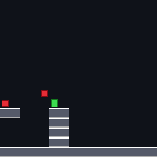
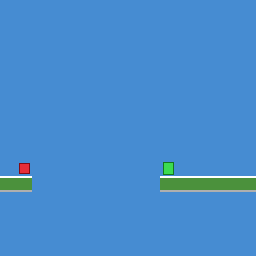
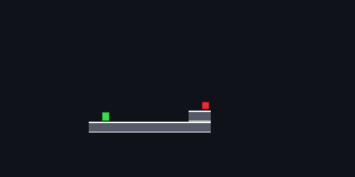
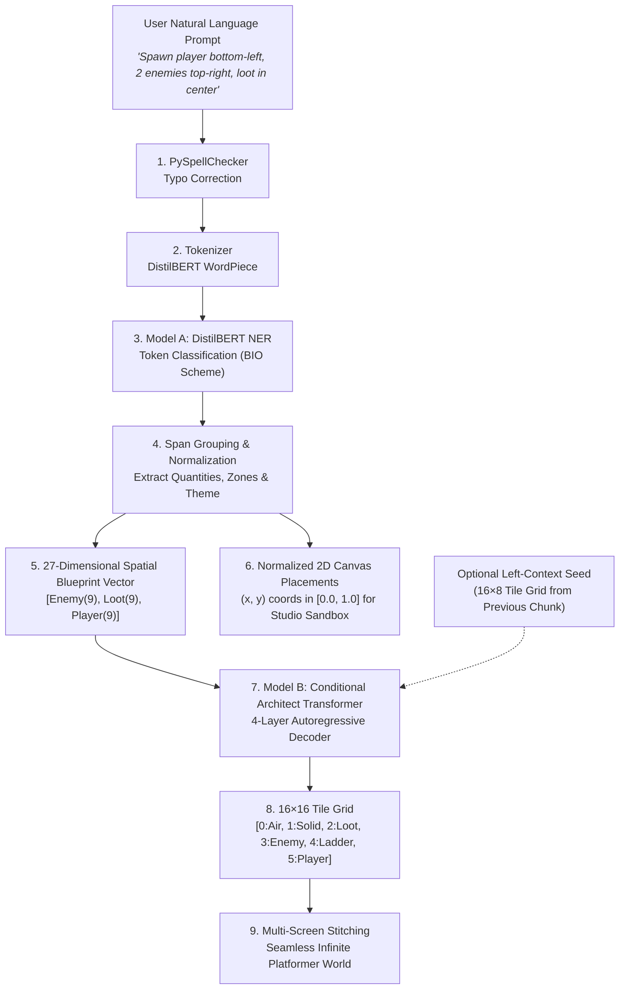

<p align="center">
  
  &nbsp;&nbsp;&nbsp;&nbsp;
  
</p>
<p align="center">
  
  <br>
  <sub><b>3-Screen Stitched Continuous Level World</b> (40 columns × 16 rows)</sub>
</p>

<h1 align="center">SpriteStack Scene Parser</h1>

<p align="center">
  <strong>Two-stage natural language scene construction & autoregressive level generator for <a href="https://github.com/Azjob21/spritestack-studio">SpriteStack Studio</a></strong>
</p>

<p align="center">
  
  
  
  
  
</p>

<p align="center">
  Natural language prompt in &rarr; structured game entities + 16×16 playable tile grid out.<br>
  Powers voice and text scene prompts with multi-screen seamless level stitching.
</p>

---

## Showcase Gallery

The pipeline transforms raw descriptive text into both 2D canvas object placements and autoregressively synthesized 16×16 tile grids.

### 1. Single-Screen Levels

<table>
  <tr>
    <th align="center">Theme: Dungeon</th>
    <th align="center">Theme: Grassland</th>
  </tr>
  <tr>
    <td align="center">
      <br>
      <sub><code>"A dark dungeon with a player on the left, two skeletons in the center, and a treasure chest on the right."</code></sub><br>
      <sub>Stone platforms (<code>##</code>) · Enemy skeletons (<code>XX</code>) · Golden chest (<code>$$</code>)</sub>
    </td>
    <td align="center">
      <br>
      <sub><code>"A peaceful grassland with a player on the left and a slime enemy on the right."</code></sub><br>
      <sub>Grass terrain (<code>##</code>) · Player spawn (<code>@@</code>) · Slime mob (<code>XX</code>)</sub>
    </td>
  </tr>
</table>

### 2. Multi-Screen Seamless World Continuation

<table>
  <tr>
    <th align="center">Screen 1 (Grassland) &rarr; Screen 2 (Rocky Pass) &rarr; Screen 3 (Castle Gate)</th>
  </tr>
  <tr>
    <td align="center">
      <br>
      <sub><b>3-Screen Continuous Level</b> (Stitched via 8-column right-edge context force-feeding)</sub>
    </td>
  </tr>
</table>

---

## Architecture: Two-Stage Generative Pipeline



---

## Deep Dive: The Two Models

### Stage 1 — Model A: SpriteStack NER Parser

* **Base Model:** `distilbert-base-uncased` fine-tuned for token classification.
* **Size:** ~265 MB (`model.safetensors`).
* **Inference Speed:** **~30.7 ms on CPU**.
* **Tagging Scheme:** BIO entity tagging across 5 classes:
  - `O`: Outside token
  - `B-OBJECT`: Sprite/entity identity (*"knight"*, *"dragon"*, *"chest"*, *"platform"*)
  - `B-COUNT`: Numeric quantities (*"two"*, *"3"*, *"several"*)
  - `B-POSITION`: Spatial anchors (*"top-right"*, *"bottom-left"*, *"center"*)
  - `B-SCENE_TYPE`: Environment theme (*"dungeon"*, *"grassland"*, *"desert"*)
* **Post-Processing:** Hyphen-gluing merges multi-token entity spans (*"fire"* + *"dragon"* &rarr; *"fire-dragon"*), converts written numbers to integers (*"three"* &rarr; 3), and normalizes positions into canonical spatial anchors.

### Stage 2 — Model B: Conditional Architect Transformer

* **Architecture:** Custom 4-layer Autoregressive Transformer with 2D row/column positional encodings.
* **Weights Size:** **3.2 MB** (`final_conditional_architect.pth`).
* **Conditioning:** 27-dimensional spatial condition vector:
  $$\text{Condition Vector} \in \mathbb{R}^{27} = \left[ \mathbf{v}_{\text{enemy}} \in \mathbb{R}^9 \;\Vert\; \mathbf{v}_{\text{loot}} \in \mathbb{R}^9 \;\Vert\; \mathbf{v}_{\text{player}} \in \mathbb{R}^9 \right]$$
  representing entity density across the 9 spatial zones (top-left through bottom-right).
* **Vocabulary:** 6 discrete level tokens:
  `0: Air`, `1: Solid`, `2: Loot`, `3: Enemy`, `4: Climbable/Ladder`, `5: Player`.
* **Dataset:** Trained on the Video Game Level Corpus (VGLC) platformer chunks and synthetic SpriteStack layout corpora.
* **Context Seeding (Stitching):** Force-feeds the rightmost 8 columns of the previous screen into columns 0..7 of the new screen during autoregressive generation, ensuring platforms and ground levels align seamlessly across chunk boundaries.

---

## Benchmarks

> Measured on Intel Core CPU (x86_64, FP32, 10 iterations)

| Stage | Component | Latency | Memory | Notes |
|---|---|---|---|---|
| **Stage 1** | DistilBERT NER | **30.70 ms** | ~280 MB | Spell-check + token classification + span merging |
| **Stage 2** | Architect Transformer | **1424.40 ms** | ~15 MB | 256 sequential autoregressive token generations |
| **End-to-End** | Full Pipeline | **1455.10 ms** | < 300 MB | Prompt &rarr; Entities &rarr; Blueprint &rarr; 16×16 Grid |

---

## Installation

```bash
# Clone repository
git clone https://github.com/Azjob21/spritestack-sceneparser.git
cd spritestack-sceneparser

# Install package & dependencies
pip install -e .

# Optional: install server & dev dependencies
pip install -e ".[all]"
```

---

## Quickstart

### 1. Python API

```python
from sceneparser import SceneConstructionPipeline, level_to_ascii, grid_to_image

# Initialize the two-stage pipeline
pipeline = SceneConstructionPipeline()

# Prompt to 16x16 level
result = pipeline.run("A dungeon with 2 knights on the left and a chest on the right.")

# Inspect entities and canvas placements
print("Theme:", result["theme"])
for p in result["placements"]:
    print(f"Object: {p['name']} at normalized (x={p['x']}, y={p['y']})")

# Print ASCII level grid
print(level_to_ascii(result["level_grid"]))

# Export PNG visual tilemap
img = grid_to_image(result["level_grid"], theme=result["theme"])
img.save("dungeon_output.png")
```

### 2. Multi-Screen Seamless World Continuation

```python
prompts = [
    "A grassy plain with a player on the left.",
    "A rocky hill with two enemies on a platform.",
    "A castle entrance with a treasure chest.",
]

wide_world = pipeline.run_wide(prompts)
print(f"Stitched World: {wide_world['width']} columns x {wide_world['height']} rows")
img = grid_to_image(wide_world["level_grid"], theme="grassland")
img.save("wide_level.png")
```

### 3. Command-Line Interface (CLI)

```bash
# Parse a prompt into JSON, placements & ASCII level
sceneparser parse "A dungeon with 2 knights on the left and a dragon on the right" -o level.png

# Generate a 3-screen continuous wide level
sceneparser wide \
  "A forest with a hero on the left." \
  "A cliff with two goblins." \
  "A cave with treasure." \
  -o wide_world.png

# Start the SpriteStack Studio backend server
sceneparser serve --host 127.0.0.1 --port 8000

# View system environment and loaded models
sceneparser info
```

---

## SpriteStack Studio HTTP API Contract

The sceneparser server implements the API contract expected by [SpriteStack Studio](https://github.com/Azjob21/spritestack-studio).

### Endpoint: `POST /parse-scene`

**Request:**
```json
{
  "prompt": "A dungeon with 2 knights on the left and a treasure chest on the right",
  "left_context": null,
  "target_screen": 0,
  "num_screens": 1
}
```

**Response:**
```json
{
  "objects": [
    { "name": "Knight", "type": "sprite", "x": 0.16, "y": 0.50, "scene_type": "dungeon" },
    { "name": "Knight", "type": "sprite", "x": 0.24, "y": 0.50, "scene_type": "dungeon" },
    { "name": "Chest", "type": "sprite", "x": 0.80, "y": 0.50, "scene_type": "dungeon" }
  ],
  "scene_metadata": {
    "raw_text": "A dungeon with 2 knights on the left and a treasure chest on the right",
    "global_theme": "dungeon"
  },
  "level_grid": [
    [0, 0, 0, 0, 0, 0, 0, 0, 0, 0, 0, 0, 0, 0, 0, 0],
    ...
    [1, 1, 1, 1, 1, 1, 1, 1, 1, 1, 1, 1, 1, 1, 1, 1]
  ],
  "model": "distilbert_ner + architect_transformer"
}
```

---

## Research Reports & Whitepapers

Comprehensive technical reports covering dataset construction, DistilBERT fine-tuning, autoregressive transformer design, and evaluation metrics are included in [`docs/research/`](docs/research/):

* **Final Report:** [`docs/research/NLP_Scene_Parser_Report_V4(Final_Version).pdf`](docs/research/NLP_Scene_Parser_Report_V4(Final_Version).pdf)
* **Short Report:** [`docs/research/Prompt_to_Scene_Short_Report.pdf`](docs/research/Prompt_to_Scene_Short_Report.pdf)

---

## Repository Structure

```
spritestack-sceneparser/
├── docs/
│   ├── samples/          # Generated showcase tilemap PNGs
│   └── research/         # Technical research reports (PDFs)
├── models/
│   ├── README.md         # Checkpoint placement instructions
│   ├── checksums.txt     # SHA256 verification hashes
│   ├── model_a/          # Tokenizer & config (model.safetensors downloadable)
│   └── model_b/          # final_conditional_architect.pth (committed in git)
├── src/
│   └── sceneparser/
│       ├── __init__.py   # Public API exports
│       ├── cli.py        # Command-line interface
│       ├── pipeline.py   # Two-stage unified pipeline
│       ├── server.py     # FastAPI microservice
│       ├── model_a/
│       │   └── parser.py # DistilBERT NER token classification
│       ├── model_b/
│       │   ├── transformer.py # 4-layer ConditionalArchitectTransformer
│       │   └── generator.py   # Autoregressive sampler & context stitcher
│       └── shared/
│           ├── scene_format.py # Entity normalization & spatial zone mapping
│           └── render.py       # ASCII & 2D pixel-art PNG tilemap renderer
├── training/
│   ├── README.md
│   ├── model_a_generate_dataset.py   # Synthetic NER dataset generator
│   └── model_b_train_transformer.py  # Kaggle/GPU training script for Model B
├── tests/                # 10 unit tests (100% passing)
├── benchmarks/           # CPU latency benchmark scripts
├── examples/             # Quickstart usage scripts
├── pyproject.toml        # PEP 621 build configuration
└── LICENSE               # MIT License
```

---

## License

This project is licensed under the [MIT License](LICENSE).
